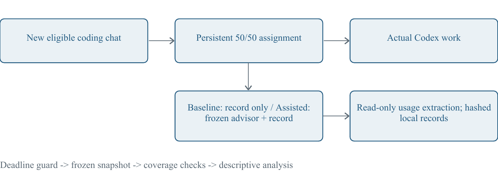
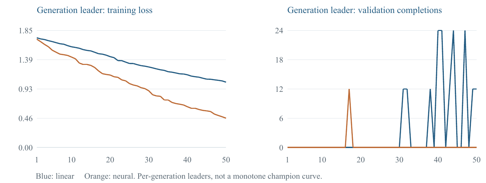
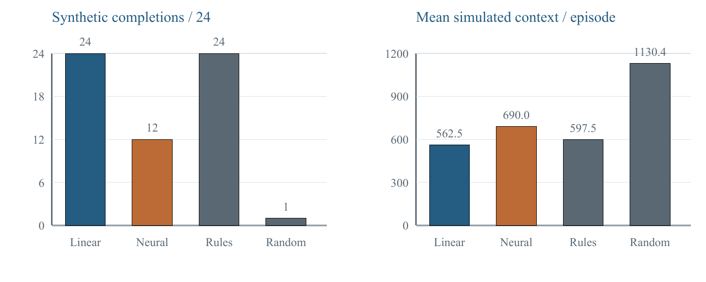
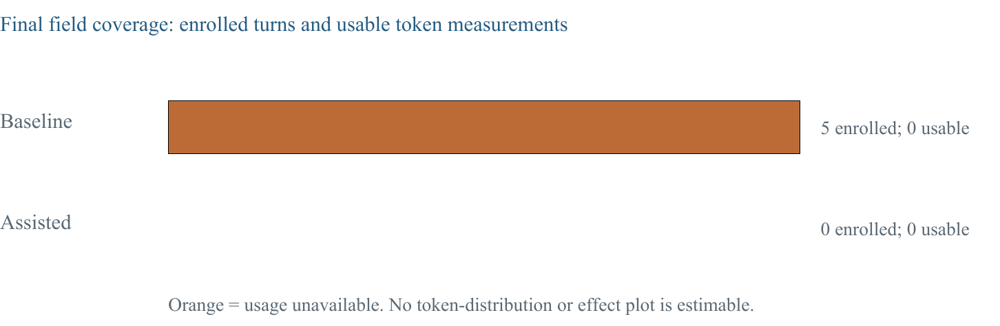

# Evolving Local Decision Controllers for Coding Assistants: A Five-Day Randomized Pilot

**Author:** sgohils  
**Technical preprint:** October 12, 2026

## Abstract

A local decision controller could reduce the cost of a coding assistant by recommending a useful next action before the assistant consumes more context or runs unnecessary tools. We implement codex-local-decider, a CPU-only NumPy prototype with a 118-parameter coefficient model and a 1,921-parameter neural model, trained by an elitist Gaussian-mutation search. In 24 scripted held-out episodes, the coefficient model and rules baseline each completed 24 episodes; the neural model completed 12, and random selection completed one. The coefficient model used 562.5 simulated context units per episode versus 597.5 for rules, a descriptive 5.858% reduction. These are oracle-assisted simulations, with only 12 distinct template/initial-state combinations, not measured Codex savings. A pre-specified five-day chat-randomized field pilot ran October 4-9, 2026 in America/New_York. It enrolled one baseline chat with five turns and no assisted chats. At final reconciliation, a shortened transcript invalidated all baseline token measurements; all five outcomes remained unknown. Consequently, neither token reduction nor preservation of task success is estimable. The contribution is a reproducible controller, integration protocol, and documented negative feasibility result. A 10% savings target remains untested, and ordinary model activation remains disabled.

Keywords: neuroevolution; coding assistants; local inference; randomized pilot; token accounting; missing measurements.

## 1. Introduction and research questions

Coding assistants alternate between reasoning and interactions with a repository: finding files, reading relevant code, examining failures, making edits, and selecting tests. The order of these interactions can affect how much evidence enters the context and how many attempts are needed. A small local policy is a plausible way to influence this order. It does not need to generate a patch or replace the assistant; it needs a narrow, inspectable decision interface and enough evidence to choose among available actions. This paper studies that restricted idea rather than general autonomous self-improvement.

The prototype arose from an interest in Jev-like typed decisions and evolution-inspired training. The resemblance is at the interface level: an observed state and a bounded set of choices enter a local function, and a selected action with scores leaves it. The implementation does not reproduce Jev, its architecture, its training method, or its calibration claims. It uses conventional fixed-size linear and neural scoring functions. Repeated training can produce a candidate checkpoint, but candidate generation is separated from activation; there is no uncontrolled recursive modification of the assistant, code, or experiment.

Three research questions organize the work. RQ1 asks whether a coefficient controller or an evolved neural controller can navigate the scripted exercises under the same evaluation budget. RQ2 asks whether ordinary-work hooks can preserve assignments and measure usage without blocking Codex. RQ3 asks whether assistance reduces reported tokens per coding turn by at least 10% without reducing observed confirmed task success. RQ1 has descriptive synthetic evidence. RQ2 has a successful initial integration demonstration followed by a final accounting failure. RQ3 is not answered by the field sample.

The experimental unit is a chat, not an individual follow-up turn. This distinction matters: an assistant carries context, previous edits, and user feedback across turns. Treating every turn as an independent sample would overstate the evidence. The target of 20 independent chats per group was an aspiration for participation, not a permission to create extra tasks or extend the fixed observation window. The paper is completed at the scheduled endpoint even when the collected evidence is insufficient.

## 2. Related work

TypeSafe AI describes Jev as a model for structured decisions over program state [1]. That product announcement motivates the interface, but its claims about speed, type guarantees, confidence, and efficiency are not evaluated here. This prototype has neither a comparable architecture nor calibrated probabilities. Restricting output to known action identifiers provides an interface check; it does not guarantee a correct recommendation.

Salimans et al. examine evolution strategies as black-box policy optimization and discuss parallel evaluation [2]. Such et al. show that a gradient-free genetic algorithm can evolve fixed neural-network weights [3]. Our implementation belongs to this broad population-search family, but is much smaller and uses reference-trajectory classification loss for parent selection. It does not implement the scalable gradient estimator from the evolution-strategies paper, novelty search, topology evolution, crossover, or a new neuroevolution algorithm. Its practical question is whether a compact controller is useful in an assistant workflow.

RouteLLM learns routers that choose between stronger and weaker language models using preference data [4]. Here the choice is a workflow action, while the Codex model remains the assistant being studied. Thus model routing is related motivation, not the mechanism of the reported savings hypothesis. SWE-bench evaluates repairs to real repository issues [5], and SWE-agent studies how agent-computer interfaces affect software-engineering behavior [6]. Those works motivate eventual repository-level evaluation and careful interface design. The tiny scripted exercises in this paper are not replacements for either benchmark, and their completion numbers are not comparable benchmark scores.

Official Codex documentation provides hooks and a machine-readable non-interactive usage stream [7,8]. The installed study used local hook-supplied transcripts, not an additional hosted evaluation run. The transcript is explicitly an unstable convenience interface [7], so validation of the installed format, response deduplication, and completeness checks are part of the experiment. A successful parser on one installation is not a general compatibility guarantee.

## 3. System and decision interface

The state contains a task description, recent observations, previous action kinds, and observable workflow flags. Each call supplies a nonempty list of unique available actions. Both trained models return a selected identifier and kind, a score for every supplied action, a score margin, an uncertainty indicator, and a model version. Checkpoint schema, feature version, parameter shape, and finite weights are validated before inference. Selecting an identifier from the supplied list constrains the interface; the semantic quality of the choice still depends on features and training.

Table 1. Six action families used by the controller.

| Action family | Role |
| --- | --- |
| Search | Find relevant code or a likely path |
| Inspect source | Read a relevant file or definition |
| Inspect failure | Gather diagnostic evidence before another attempt |
| Focused test | Choose a narrow verification step |
| Broader test | Check wider behavior after focused progress |
| Defer | Leave the decision to Codex |

The controller offers advice. Codex continues to decide which concrete command, edit, or tool call to perform. The advisor does not itself search a real repository, modify source, or certify task completion. This separation preserves a small decision surface and also limits the intervention: a delivered recommendation may be ignored, may already match the assistant's plan, or may be unsuitable outside the training distribution. A field comparison must therefore record delivery separately from inference and analyze chats by their original assignment.

### 3.1 Features and model equations

For each state-action pair, the feature vector has 118 coordinates. The first 64 count lowercased text tokens using a stable BLAKE2s hash bucket, with at most 1,024 token matches. The text part is normalized to Euclidean norm 0.2 when nonzero. Six action-specific blocks contain nine coordinates each: a bias, seven workflow flags, and a clipped repetition feature. The flags are path known, source seen, failure seen, failure inspected, patched, focused test passed, and broad test passed. Repetition is the action-kind count clipped at three and divided by three. This representation loses word order and has hash collisions; it is not a learned semantic embedding.

$$
\phi(s,a)\in\mathbb{R}^{118},\qquad f_{\rm lin}(s,a)=w^{\mathsf T}\phi(s,a).
$$

$$
f_{\rm nn}(s,a)=v^{\mathsf T}\tanh(W^{\mathsf T}\phi(s,a)+b)+c,\qquad W\in\mathbb{R}^{118\times16}.
$$

The linear model has 118 parameters. The neural model has 118 x 16 + 16 + 16 + 1 = 1,921 parameters. Neither model changes its topology during training. Stable descending score order gives deterministic tie handling. Deployment marks a call uncertain if a simple coding-task keyword check fails or if the highest two scores differ by less than 0.05. When a defer action is available, uncertainty selects it. The margin is an uncalibrated heuristic, not a probability or a confidence interval.

$$
\Delta=f(s,a_{(1)})-f(s,a_{(2)}),\qquad \mathrm{uncertain}=\neg\mathrm{coding}(s)\;\lor\;(\Delta<0.05).
$$

The simulation uses raw argmax scores; deployed advice additionally applies uncertainty, explicit deferral, and repeated-advice suppression. That difference prevents direct transfer of a simulated completion rate to expected deployed behavior. No calibration evaluation was conducted. Score validity and action membership were tested, but these checks do not establish correct recommendations on unseen coding tasks.



## 4. Evolution procedure and reproducibility

Both models use the same seeded, CPU-only NumPy evolution procedure. The default population contains 24 candidates, with four parents retained exactly and 20 mutated descendants. Initial parameters are independent normal draws with standard deviation 0.2. Each descendant inherits one parent in round-robin order. Independent normal mutation noise with standard deviation 0.15 is masked coordinate-wise with probability 0.1. There is no crossover, gradient calculation, backpropagation, parameter expansion, or automatically rewritten training code.

$$
\theta_i^{(0)}\sim\mathcal{N}(0,0.2^2 I),\qquad\theta_j^{(g+1)}=\theta_{p(j)}^{(g)}+m_j\odot\epsilon_j,
$$

$$
m_{jk}\sim\operatorname{Bernoulli}(0.1),\qquad\epsilon_{jk}\sim\mathcal{N}(0,0.15^2).
$$

Reference trajectories from the synthetic training split provide state-action examples and preferred action labels. The saved run contains 486 training decisions. Candidate parents are ranked using inverse-class-frequency weighted softmax cross entropy, with a small mean-squared parameter penalty. This balances rare action labels so a frequent action cannot dominate the objective simply by its frequency. The softmax is used to compute a training loss, not to provide calibrated deployment probabilities.

$$
\alpha_i=1/n_{y_i},\qquad L(\theta)=\frac{\sum_i\alpha_i[-f_\theta(s_i,a_{y_i})+\log\sum_a e^{f_\theta(s_i,a)}]}{\sum_i\alpha_i}+10^{-4}\frac{\|\theta\|_2^2}{d}.
$$

The best training-ranked candidate in each generation is evaluated on validation episodes. The retained champion is chosen lexicographically by completed episodes, progress, negative mean proxy context, and negative redundant steps. Thus one additional completion outranks a lower proxy cost within validation selection. Parent selection itself is the dense reference-loss objective; it should not be described as selecting the population exclusively by real task completion. The two objectives serve different roles in the code.

$$
Q=(N_{\rm completed},\;\overline{\mathrm{progress}},\;-\overline{\mathrm{proxy}},\;-\overline{\mathrm{redundant}}).
$$

Runs are bounded to two worker threads, at most 50 additional generations per training invocation, a 15-minute training budget, and a 12-step default episode limit. The configured maximum is 50 generations; the saved comparison completed all 50 for both models. Checkpoints preserve the population, generator state, generation, history, champion, configuration, dataset digest, and a fixed experience snapshot. Resume rejects incompatible model, dataset, algorithm, or mutation settings. The saved final-run champions are linear-s7-g40 and neural-s7-g17, although evolution continued after the selected generations.

```text
For each bounded generation:
  score all candidates on reference training decisions
  retain four best parents unchanged
  evaluate the training leader on validation workflows
  retain a lexicographically better validation champion
  create twenty masked Gaussian-mutated descendants
  save champion, population, history, and generator state
```

The comparison uses training seed 7 and algorithm version 3. Repository/template splits and fixture programs are deterministic; this seed changes evolutionary sampling rather than producing independent benchmark corpora. Prior development iterations inspected synthetic test metrics, so the final saved run is reproducible but not a pristine untouched test. Multiple training seeds, new held-out repositories, and independent harness review remain necessary for stronger claims.



## 5. Synthetic debugging experiment

Local Python fixtures contain seeded defects and verifiable evidence-gathering and test objectives. Separate synthetic repository/template groups supply nine training templates, three validation templates, and three test templates. Eight variants per template yield 72 training, 24 validation, and 24 test episodes. However, the variants encode only four distinct initial flag combinations, each repeated. The held-out test therefore contains 12 distinct template/initial-state combinations, not 24 independent coding tasks. The same scripted workflow machinery and repair oracle are shared across these exercises.

The four policies were evaluated on the same 24 test episodes under the same 12-step budget and starting conditions. A rules policy follows the reference action progression; a seeded random policy samples available actions. The harness performs reference repairs, so a completed episode is evidence that a decision policy navigated this state machine, not that it generated a correct patch autonomously. The context metric is a simulated estimate assigned to tool outputs. No tokenizer, Codex usage endpoint, billing record, or real assistant-token measurement produced these proxy values.

Table 2. Saved held-out synthetic comparison; proxy units are not Codex tokens.

| Policy | Completed | Mean proxy | Mean steps | Redundant steps |
| --- | --- | --- | --- | --- |
| Linear | 24/24 | 562.50 | 6.25 | 0.50 |
| Neural | 12/24 | 690.00 | 8.50 | 4.25 |
| Rules | 24/24 | 597.50 | 6.75 | 0.00 |
| Random | 1/24 | 1130.42 | 12.00 | 8.83 |

$$
1-\frac{562.5}{597.5}=0.0585774\ldots\quad\text{(simulated context reduction only).}
$$

The linear controller matched rules on completion while using 35 fewer proxy units per episode. Its mean steps were 6.25 versus 6.75 for rules, although its redundant-step count was higher, 0.50 versus zero. The neural controller completed half the episodes and had a larger all-episode mean proxy cost of 690. Its success-only proxy mean, 470, is lower but conditions on successful episodes and cannot replace the all-attempt comparison. Random selection completed one episode and reached the 12-step limit on average. These descriptive numbers support choosing the linear model for a bounded integration pilot; they do not establish a general advantage of linear models or an economic benefit.

The validation-selected coefficient checkpoint is frozen throughout the field study. Both models completed the configured 50 generations, but their validation champions occurred at different generations. Learning curves retain all saved generation-leader evaluations. Confidence intervals and significance tests are omitted for the synthetic table because the repeated starts, small template set, shared scripted repairs, one seed, and development exposure to test metrics do not justify treating the 24 episodes as independent evidence of broad performance.



## 6. Hook integration and accounting

Eight user-level events support the collector: SessionStart, UserPromptSubmit, PostToolUse, Stop, Interrupt, SessionEnd, SubagentStart, and SubagentStop. Normal existing hook entries are preserved. Recommendations are concise additional context after observed tool activity, with a 100-token handler context limit, duplicate suppression, uncertainty handling, and a three-second configured command timeout. Baseline returns empty output and does not load the advisor. A missing, corrupted, uncertain, or deferred model recommendation allows ordinary work to continue. These properties bound the intervention; they do not guarantee complete measurement coverage of every specialized tool path [7].

Token collection reads only the transcript identified by an enrolled hook and admitted under configured transcript roots. Per-response usage records are preferred. Hashed response identifiers deduplicate repeated parent/child records and replace provisional cumulative estimates. The fallback computes differences between monotonic cumulative token counters. Nonmonotonic usage, malformed records, unknown formats, missing child usage, truncation, and unread backlog invalidate the affected measurement. Input and output tokens are added; cached-input tokens are recorded as a subset of input and are not added again. Reported tokens are not billed dollars, subscription allowance, or a pricing calculation.

$$
T_t=I_t+O_t,\qquad 0\leq C_t\leq I_t,\qquad T_t\ne I_t+C_t+O_t.
$$

Subagent activity is associated with the parent chat rather than enrolled as another independent chat. Child usage must be observed for a parent turn to be usable. No subagent activity was recorded in the enrolled field chat, so grouping and missing-child handling have test evidence but no empirical field validation in this pilot. Failed or interrupted attempts remain in assigned groups, with unavailable measurements explicitly unknown. A test-pass flag after a patch is distinct from a confirmed solved outcome; optional operator annotations require supporting evidence and store only its hash.

The parser limits ordinary records to 256 KB and consumption to 8 MB per read. A 2,343,871-byte top-level content record initially stalled reconciliation. The published repair streams past content-only response records in bounded chunks, preserves partial-record state, and invalidates oversized records of other types instead of silently accepting them. Delayed probe reconciliation and complete child-usage checks were also repaired. Six regression cases brought the implementation to 42 tests, which passed Windows and Linux CI. Installing the tested source and refreshing ordinary usage automatically verified the probe and began the clock; no manual timestamp was used.

Internal timers separate inference from collection. They exclude interpreter startup and final record writes, and the probe-reconciliation path is outside those turn timers. Guidance inserted into the assistant context would be counted by actual assistant usage when measurement is complete. Local NumPy computation has CPU/time cost but no additional language-model token counter. Monitoring and paper-generation work are excluded from the coding comparison; their own aggregate token cost and total CPU time were not measured. The reported internal timer must not be presented as the full overhead of the helper or experiment.

## 7. Pre-specified randomized field protocol

The protocol was specified before field collection in the project documentation and approved study plan; it was not registered with an external registry. Eligible units were newly created ordinary coding chats in recognizable local coding projects. Existing chats, research, study maintenance, the decider repository, and plan-mode turns were excluded. Enrollment used an explicit coding/research keyword heuristic and project detection. Thus the sampling frame is enrolled chats, not all coding work performed by the user; a screening denominator and false-negative enrollment rate were not recorded.

Chats were assigned 50/50 using reproducible blocks of four, with two baseline and two assisted entries, stratified by hashed project and initial Codex model. Seed 20261001 and stratum-derived seeds determine shuffles. Assignment is written before tool outcomes are observed. The assignment persists across follow-ups, resume, restart, and compaction. Incomplete blocks can be imbalanced: one enrolled chat can legitimately be baseline with no assisted observation. The helper does not advise every task, and no extra coding trials were launched to fill an arm.

The model checksum and version linear-s7-g40 were fixed. Ordinary activation remained separate from the experiment. Candidate-only retraining could begin after 25 completed eligible episodes under the existing bounded budget, but could not replace the study model. Only four completed episodes were recorded, so this trigger did not occur and background retraining wall time was zero. The earlier controlled fresh-checkout attempt failed during Windows CLI startup, completed zero pairs, and supplied no valid usage. It is an integration limitation, not additional field evidence.

The initial probe is excluded from randomized analysis. While collection was still armed, three chats entered this pre-start category, totaling nine turns. At the user's explicit request, advice was enabled in one excluded probe, creating a timestamped protocol amendment on October 3. Fourteen model decisions delivered one recommendation. These observations demonstrate that the advisor executed, not that it reduced cost. Their measurements and outcomes never enter the randomized estimate. Exposure to this demonstration could influence later user or assistant behavior and is a possible spillover effect.

Table 3. Actual study timing in America/New_York.

| Milestone | Observed timing |
| --- | --- |
| Automatic collection verification | October 4, 2026, 5:27:21 p.m. EDT |
| Five-day deadline | October 9, 2026, 5:27:21 p.m. EDT |
| Dataset freeze | October 12, 2026, 09:22:54 PM EDT |
| Observation window | Exactly 432,000 seconds; not extended for participation |
| Model | linear-s7-g40; checksum fixed |

The deadline guard stops experimental advice at the original endpoint, even if the monitor runs later. On the October 12 Eastern follow-up, permission for the chat's folder allowed the normal stop command to reconcile and freeze the dataset. Hook removal was outside the granted file scope, so the supported keep-hooks option retained this installation's definitions as no-ops under the expired registry. Late finalization did not extend the window. Reconciliation accepts only usage records timestamped within the original five days.

## 8. Analysis plan and estimands

The primary descriptive measure is the ratio of mean measured reported tokens per coding turn across assigned arms. Failed attempts and interrupted work with usable records belong in that mean. Every enrolled chat remains in the coverage and outcome accounting, including those with missing usage. The primary estimand is therefore conditional on measurement availability; differential missingness must be reported and can prevent a causal interpretation. Actual guidance tokens belong to assisted usage rather than being subtracted as a helper discount.

$$
\overline T_g=\frac{\sum_{t\in\mathcal M_g}(I_t+O_t)}{|\mathcal M_g|},\qquad R=1-\frac{\overline T_{\rm assisted}}{\overline T_{\rm baseline}}.
$$

If an arm has no measured turns, its mean is undefined, not zero. Per-chat totals, project/model composition, follow-ups, elapsed time, inference and collection timers, advice delivery, failure flags, test observations, confirmed outcomes, and missing measurements accompany the main metric. Whole-chat bootstrap resampling preserves dependence among follow-up turns. The planned procedure uses 10,000 seeded resamples separately within each arm and percentile 95% intervals. With fewer than ten measured independent chats in either arm, the comparison is labeled inconclusive and no interval is produced. Ten chats is a reporting threshold, not a power calculation.

The 10% reduction target also requires no decline in observed confirmed success. Unannotated outcomes remain unknown, and observed test passes cannot establish successful task completion. The ordinary activation gate is stricter and separate: at least 12 valid paired fresh-checkout tasks, a delivered recommendation, at least 10% lower reported tokens, and no observed success decline. Neither the unsuccessful startup attempt nor this field pilot satisfies that gate. No candidate was promoted.

## 9. Field results and measurement failure

The randomized pilot enrolled one baseline chat in one local project using model identity gpt-6.1-sol. It contained five turns: four completed assistant turns and one interrupted turn. There were four follow-ups, no assisted chats, no deployed field recommendations, and no recorded subagents. The session remained unclosed in the collector, despite the four Stop events; that session flag and confirmed task completion are distinct. The interrupted turn had no supported usage record. All five outcome annotations remained unknown.

Table 4. Frozen randomized coverage and observed flags. NA denotes unavailable usage, not zero cost.

| Metric | Baseline | Assisted |
| --- | --- | --- |
| Independent chats | 1 | 0 |
| Coding turns | 5 | 0 |
| Completed / interrupted turns | 4 / 1 | 0 / 0 |
| Usable token turns at freeze | 0 | 0 |
| Turns with unavailable usage | 5 | 0 |
| Reported input / cached / output totals | NA / NA / NA | NA / NA / NA |
| Mean tokens per measured turn | NA | NA |
| Follow-up turns | 4 | 0 |
| Unclosed chats | 1 | 0 |
| Tool calls / failure flags | 283 / 53 | 0 / 0 |
| Test-run / pass / failure flags | 14 / 1 / 3 | 0 / 0 / 0 |
| Test-verified turns after last patch | 0 | 0 |
| Confirmed outcomes / unknown outcomes | 0 / 5 | 0 / 0 |
| Retry-proxy repair cycles | 4 | 0 |
| Recommendations / model decisions | 0 / 0 | 0 / 0 |
| Recorded subagents / missing child usage | 0 / 0 | 0 / 0 |
| Internal collection seconds | 7.094 | 0 |
| Internal advisor inference seconds | 0 | 0 |
| Sum elapsed ended-turn seconds | 72,159.636 | 0 |

Before finalization, cached counters were present for four baseline turns, and interim monitor checks reported four usable turns by October 7, including one then-open turn. Final reconciliation found the enrolled transcript smaller than the previously stored byte offset. The reader records transcript_truncated and conservatively rejects the stream instead of resetting counters and risking double-counting or omissions. All five baseline turns are therefore unusable under the registered completeness rule. The three excluded probe streams were also shorter than their offsets. Retained counters are preserved privately for audit but are not reinstated as validated measurements.

File-size regression is directly observed; its cause is not established. The study did not distinguish app rewriting, compaction-related changes, retention, or another process. There was no attempt to edit Codex history or repair a transcript. A supported stable usage interface or an append-only validated usage journal would be needed for a later experiment. The final completeness failure changes the evidence relative to interim status updates, and that change is reported rather than hidden.

The analyzer's internal empty-sum total is zero when no measurements qualify. The research export converts such token totals and cached/input/output aggregates to null, displayed as NA, because zero qualifying observations does not imply zero tokens consumed. The assisted arm also has no enrolled observations, so its workload cost and mean are unavailable rather than evidence of a free intervention. No token distribution, reduction estimate, confidence interval, or observed success-preservation claim can be produced.



Observed activity flags remain useful for feasibility reporting. There were 283 tool-call notifications and 53 response-summary failure flags, not 53 independently adjudicated task failures. Four repair-cycle flags are a retry proxy, not a count of every failed coding attempt. Four follow-ups are reported separately. Fourteen test-run flags included one pass flag and three failure flags; remaining runs had no recognized pass/failure classification. No turn was test-verified after its last patch, and no operator confirmed a solved or unsolved task. A completed assistant turn should not be called a successful task.

The collector recorded 7.094 internal collection seconds and no advisor inference time in the baseline arm. The summed elapsed time of ended turns was 72,159.636 seconds, about 20.04 hours. That duration can include approval waits, interruptions, user delays, and tool latency; it is not processor time or a throughput benchmark. No assisted timing comparison is available. Monitor checks, interpreter startup, final writes, and manuscript production lack a complete aggregate overhead measurement, so a net economic comparison is unavailable.

## 10. Limitations and threats to validity

Participation and randomization. One baseline chat and no assisted chats are insufficient for an effect estimate even if accounting were complete. Blocking balances assignments over completed blocks, not every short prefix or stratum. Four follow-ups do not create five independent tasks. One user, one enrolled project, a single observed model identity, unrecorded enrollment exclusions, and unknown task difficulty restrict generalization. No external registration or independently run replication was conducted.

Measurement and monitoring. Local transcript schema is unstable [7]. Setup documentation named runtime 0.159.3, while the enrolled rollout metadata recorded 0.159.2; we retain the observed metadata rather than infer uniform compatibility. The final truncation warning removes all usable field tokens. During the observation window, scheduled sessions also failed to refresh or update their monitor file because of read-only permissions or Windows split-root process enforcement. Read-only inspections could detect saved activity but could not force reconciliation. These limitations delayed finalization and reduced assurance about continuous instrument coverage.

The scheduled process limitations do not themselves prove that ordinary trusted hooks stopped executing: later saved hook timestamps and turn updates demonstrate activity. Conversely, such activity does not prove complete token coverage. The deadline guard was verified in the installed source and the final registry was frozen with the normal command, but there is no claim of a separately measured notification event at the precise deadline. A future monitor should have narrowly authorized writes and a stable, independently testable usage source before enrollment begins.

Synthetic external validity. Four distinct starting conditions are repeated, only three templates are held out, repairs are scripted, and test metrics influenced earlier development. Shared exercise logic can induce a policy that learns the state machine rather than general debugging. The text encoder has no semantic training and uses a small hash space. A single evolutionary seed cannot distinguish algorithmic performance from initialization sensitivity. The raw-score simulation differs from abstaining deployment, and the neural controller's lower completion rate does not establish that a linear controller will dominate other architectures or training methods.

Outcome and cost validity. Test classification and failure flags are heuristic observations from tool summaries. Unknown outcomes cannot demonstrate preserved success. Missing tokens cannot be filled with zero, imputed from simulated context, or converted to a billed price. Caching, model configuration, approval delays, intervention uptake, and different task difficulty can all affect a real comparison. The reported internal timers omit substantial process boundaries, and no monitor cost allocation was pre-measured. The 10% target is a hypothesis that remains unevaluated, not a result that merely missed a significance threshold.

Interference and adaptation. The optional excluded-probe recommendation could change subsequent behavior. Shared memory, user learning, and multiple assistant settings may create spillover between chats, while a single project provides little protection against correlated tasks. Background retraining stayed inactive in this run; future candidates must remain separate throughout any registered experiment. Automatically replacing the intervention would confound model learning with its treatment effect and violate this pilot's fixed-model protocol.

## 11. Privacy, reproducibility, and verification

Local study records retain hashed identifiers, numeric measurements, flags, and outcome summaries. Reconciliation metadata includes local transcript paths, which remain private. Full prompts, source from other projects, credentials, evidence files, and raw transcripts are not included in research artifacts or Git. Operator evidence is hashed rather than copied. Published artifacts contain only group-level counts, synthetic results, learning-curve data, model/configuration identifiers, and dataset/checkpoint commitments. The private repository remains private.

Implementation commit a777f2329bcf56769c208fd2a75d84de69c12755 identifies the installed repair. The model SHA-256 and frozen-export SHA-256 are recorded in aggregate-results.json. A frozen dataset commitment supports checking a local copy without publishing chat or project hashes. Reproduction can regenerate the synthetic comparison from shipped synthetic checkpoints and saved curves. Reproducing the real field trial requires the private local records and an equivalent eligible workload; those records are not distributed. Aggregate files permit deterministic re-computation of reported counts, means, coverage, and the simulated reduction, not an independent reconstruction of user work.

The implementation's 42-test Windows and Linux CI runs covered deterministic evolution, action validity, checkpoint recovery, dataset isolation, limits, persistent assignments, concurrency, duplicate accounting, interruptions, expiry, model failures, privacy filtering, subagent coverage, and hook restoration. These tests did not protect against the observed real transcript-size regression sufficiently to preserve usable field data. Passing tests established the tested behaviors, not effectiveness or successful task completion. Final artifact checks verify tables against the frozen export, ensure privacy exclusions, validate the standalone LaTeX, and inspect the rendered PDF.

## 12. Discussion and next experiments

The coefficient policy is a reasonable engineering candidate for further evaluation within this limited simulator, but evidence for actual token savings is absent. The field result is an instrument-and-participation failure rather than an unfavorable measured treatment effect: there is neither an assisted sample nor a valid baseline mean. This distinction matters for future work. Improving a policy cannot compensate for unidentifiable outcomes, unstable counters, or an unpopulated comparison arm. The most immediate research improvement is reliable accounting and verified enrollment coverage.

A subsequent study should first validate an append-only usage capture or supported usage stream under interrupted turns, transcript rewriting, compaction, restarts, concurrent subagents, and offline monitoring. It should record eligibility counts without retaining private prompts, complete a feasibility phase outside the randomized sample, and obtain enough independent projects and chats for a justified uncertainty analysis. Controlled paired tasks with fresh checkouts can complement ordinary-work randomization, provided tasks, order, token budgets, success criteria, and exact model versions are specified in advance. None were launched to supplement this pilot.

Multiple training seeds, new held-out templates, adversarial or unfamiliar states, score-margin calibration, and explicit uptake measurements could test whether the controller generalizes. A baseline matching the guidance's framing and context length could distinguish policy information from generic prompting or additional context. A larger confirmatory trial would need a power or precision analysis and a documented missing-data strategy. Such work is a proposed follow-up, not an automatic extension of the completed five-day study.

## 13. Conclusion

A compact, local action scorer can be implemented and evolved reproducibly without generating code or changing its own topology. In the saved scripted experiment, a coefficient controller completed 24/24 episodes and used about 5.9% less simulated context than rules, while an evolved neural controller completed 12/24. The five-day randomized pilot enrolled only one baseline chat, no assisted chats, and yielded no usable final token measurements after transcript truncation. It therefore provides no estimate of token savings or preserved task success. The active-model gate remains unmet. The complete preliminary preprint reports the prototype, protocol, observed failures, and reproducibility artifacts so later work can improve measurement before making efficiency claims.

## AI assistance disclosure

Codex assisted with implementation, tests, instrumentation, literature verification, aggregation, manuscript drafting, and artifact generation under the author's instructions. The provisional author is sgohils; no affiliation is asserted. This is an AI-assisted technical preprint, not a peer-reviewed publication. No human expert review, independent replication, or claim of a validated new learning algorithm is implied. The author should review scientific claims and references before external submission.

## Appendix A. Reproducible configuration and metric conventions

Table A1. Saved training and study configuration.

| Setting | Value |
| --- | --- |
| Python / inference | Python 3.13; isolated environment; NumPy CPU |
| Evolution seed / study seed | 7 / 20261001 |
| Candidates / unchanged parents | 24 / 4 |
| Worker threads / generations | 2 / 50 |
| Training limit / episode limit | 15 minutes / 12 steps |
| Initial / mutation standard deviation | 0.2 / 0.15 |
| Coordinate mutation probability | 0.1 |
| Text / action features | 64 + 6 x 9 = 118 |
| Neural hidden width / parameters | 16 / 1,921 |
| Dense regularization coefficient | 0.0001 |
| Uncertainty margin | 0.05; uncalibrated |
| Assignment block size | 4: two baseline, two assisted |
| Field window / participation target | 5 days / 20 chats per arm |
| Bootstrap plan | 10,000 whole-chat draws; omitted below 10 measured chats/arm |

The public aggregate uses null for unavailable token counts and means. Counts of enrolled chats, interrupted turns, advice deliveries, and test flags can be zero observations; a zero count is not a zero usage estimate. No per-chat row or project identifier is published. The internal analyzer's empty-sum convention is documented and normalized during sanitized export. The retained-counter indicator only reports presence of privately cached counters, not their validation or a complete total.

```text
Synthetic evaluation from the private implementation checkout:
  python -m local_decider --help
  python -m local_decider evaluate --help
  python -m local_decider report --help

Local field finalization (private data directory):
  python -m local_decider.study status --data-dir LOCAL_STUDY --refresh
  python -m local_decider.study stop --data-dir LOCAL_STUDY --keep-hooks
  python -m local_decider.study analyze --data-dir LOCAL_STUDY --output PRIVATE_JSON

Sanitized aggregate verification:
  python verify_aggregate_results.py aggregate-results.json
```

The editable .tex is standalone: references and figure coordinates are embedded, with no external figure or bibliography files required. The delivered PDF is rendered from the same manuscript blocks with ReportLab, not exported by the built-in LaTeX compiler. The LaTeX source is separately opened and compiled for diagnostics. SVG, PDF, and PNG figures and their CSV data are retained for inspection and reuse. Rendering provenance and compilation verification are reported in the delivery manifest.

## References

[1] Diogo Almeida / TypeSafe AI. Introducing System One Models & Jev. Online announcement; accessed October 12, 2026. [Introducing System One Models & Jev](https://typesafe.ai/blog/introducing-system-one-models-and-jev).

[2] Tim Salimans, Jonathan Ho, Xi Chen, Szymon Sidor, and Ilya Sutskever. Evolution Strategies as a Scalable Alternative to Reinforcement Learning. 2017, arXiv:1703.03864. [Evolution Strategies as a Scalable Alternative to Reinforcement Learning](https://arxiv.org/abs/1703.03864).

[3] Felipe Petroski Such, Vashisht Madhavan, Edoardo Conti, Joel Lehman, Kenneth O. Stanley, and Jeff Clune. Deep Neuroevolution: Genetic Algorithms Are a Competitive Alternative for Training Deep Neural Networks for Reinforcement Learning. 2017; revised 2018, arXiv:1712.06567. [Deep Neuroevolution: Genetic Algorithms Are a Competitive Alternative for Training Deep Neural Networks for Reinforcement Learning](https://arxiv.org/abs/1712.06567).

[4] Isaac Ong, Amjad Almahairi, Vincent Wu, Wei-Lin Chiang, Tianhao Wu, Joseph E. Gonzalez, M. Waleed Kadous, and Ion Stoica. RouteLLM: Learning to Route LLMs with Preference Data. 2024; revised 2025, arXiv:2406.18665. [RouteLLM: Learning to Route LLMs with Preference Data](https://arxiv.org/abs/2406.18665).

[5] Carlos E. Jimenez, John Yang, Alexander Wettig, Shunyu Yao, Kexin Pei, Ofir Press, and Karthik Narasimhan. SWE-bench: Can Language Models Resolve Real-World GitHub Issues?. ICLR 2024, arXiv:2310.06770. [SWE-bench: Can Language Models Resolve Real-World GitHub Issues?](https://arxiv.org/abs/2310.06770).

[6] John Yang, Carlos E. Jimenez, Alexander Wettig, Kilian Lieret, Shunyu Yao, Karthik Narasimhan, and Ofir Press. SWE-agent: Agent-Computer Interfaces Enable Automated Software Engineering. 2024, arXiv:2405.15793. [SWE-agent: Agent-Computer Interfaces Enable Automated Software Engineering](https://arxiv.org/abs/2405.15793).

[7] OpenAI. Codex Hooks. Official documentation; accessed October 12, 2026. [Codex Hooks](https://learn.chatgpt.com/docs/hooks).

[8] OpenAI. Codex Non-interactive Mode. Official documentation; accessed October 12, 2026. [Codex Non-interactive Mode](https://learn.chatgpt.com/docs/non-interactive-mode).
